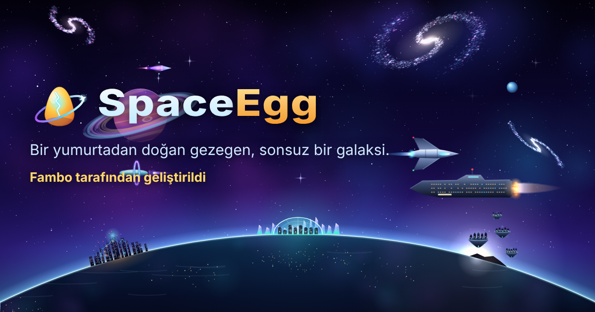
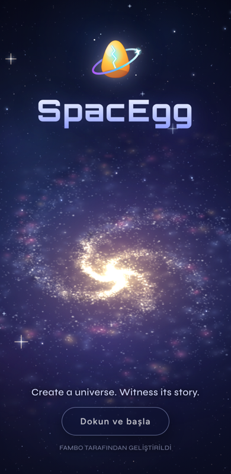
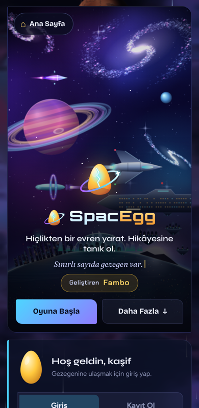
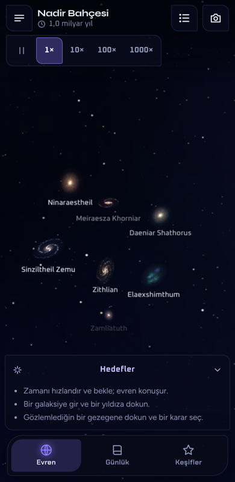
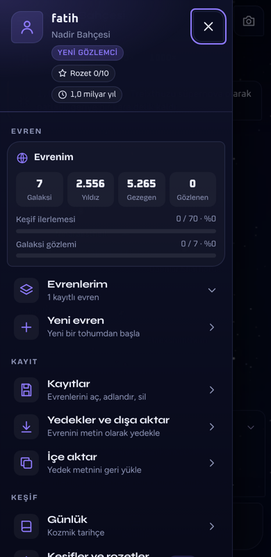
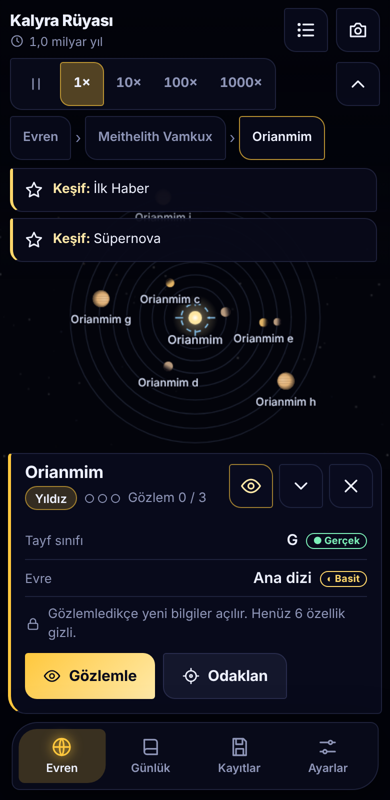
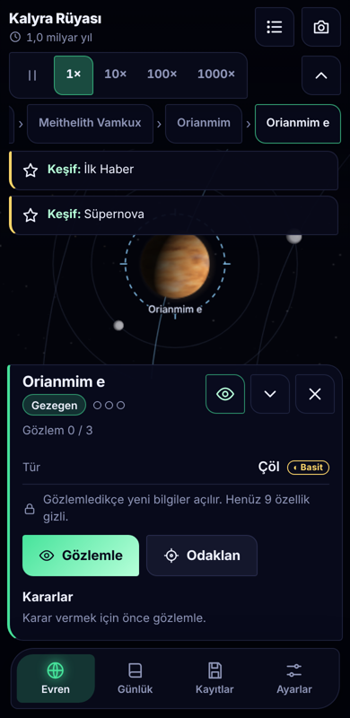
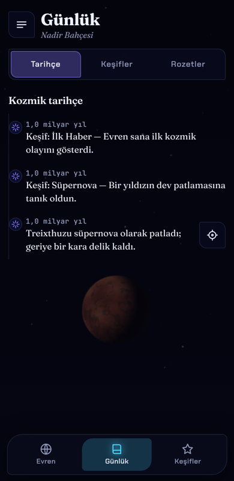
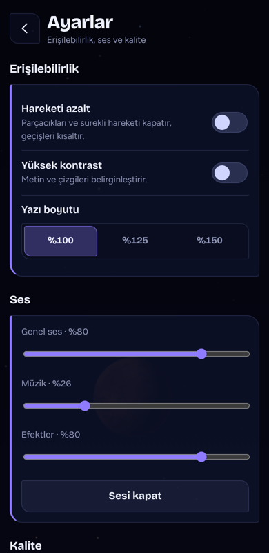

<p align="center"></p>

# SpacEgg 2.1 — Evren Yaratma Simülatörü
> *Create a universe. Witness its story.*

Hiçlikten bir evren yarat, galaksileri keşfet, yıldızların ve dünyaların hikâyesini izle. SpacEgg; kozmik ölçeği hissettiren, bilimden ilham alan, baskı yapmayan sakin bir keşif oyunudur. Android'de WebView kabuğu içinde tek dosyalık bir web uygulaması olarak çalışır.

**En yeni kurulum dosyası:** [`releases/SpacEgg-v2.1.0.apk`](releases/SpacEgg-v2.1.0.apk) · Android 7.0+ · paket `com.spacegg.app` · sürüm 2.1.0 (kod 7)

## Ekranlar
<p>
   
</p>
<p>
   
</p>

Soldan sağa: açılış, giriş, evren, çekmece menü · yıldız sistemi, gezegen, günlük, ayarlar.

## Neler var
- Tohumdan evren; Evren → Galaksi → Yıldız sistemi → Gezegen kesintisiz yakınlaşma
- Zamanı durdurma ve 1000 katına kadar hızlandırma; yıldız yaşam döngüsü, yörüngeler, kozmik olaylar
- Gezegen iklimi: su ve atmosfer kararlarının sonucu önce/sonra gösterilir
- 70 keşif, rozetler, kozmik günlük, hedef ipuçları
- Sürümlü kayıt, 3 yedek, dışa/içe aktarma (`SGU2:` metni), kullanıcıya ayrı kayıt
- Dikey açılış ekranı (logo + büyük galaksi), sol kenardan açılan çekmece menü
- 9 gömülü yazı tipi ailesi (Türkçe karakter doğrulamalı)
- Erişilebilirlik: hareketi azalt, yüksek kontrast, yazı boyutu %100/125/150, 44 px dokunma alanı
- Kalite kademeleri (otomatik/düşük/orta/yüksek), fotoğraf modu
- Her bilgi "gerçek / basitleştirilmiş / kurgu" etiketli; zorunlu seri, bekleme duvarı, ödemeye bağlı ilerleme yok
- Her açılışta giriş (kayıtlı oturum yok); eski v1 oyunu çekmeceden açılır

## Android kurulumu
1. `releases/SpacEgg-v2.1.0.apk` dosyasını telefona indir.
2. "Bilinmeyen uygulamaları yükle" iznini dosyayı açan uygulamaya ver ve dosyaya dokun.
3. Eski sürümün üzerine kurulur; aynı imza anahtarı gerekir (anahtar depoda yoktur).

## Depo yapısı
| Klasör | İçerik |
|---|---|
| `game/` | Oyun kaynağı: `src/`, `css/`, `data/`, `tests/`, `tools/`, `build.py` |
| `android/` | WebView kabuğu, manifest, `build.sh`, ikonlar, müzik |
| `releases/` | Tüm APK sürümleri (v1.0.1 … v2.1.0) |
| `docs/` | Mimari, karar kaydı, değişiklik günlüğü, tasarım, test ve yayın belgeleri |
| `assets/` | Logo, ikon, ekran görüntüleri |

## Derleme ve test
```bash
cd game
python3 -I build.py --min          # game/dist/SpacEgg.html (sürüm data/version.json'dan)
node tests/run.js                  # başsız Chrome ile 12 test
../android/build.sh                # APK (aapt, javac, dalvik-exchange, zipalign, apksigner)
```
`src/*.js` ve `css/*.css` ad sırasıyla birleşir. Sürümün tek kaynağı `game/data/version.json`'dır.

## Mimari
| Modül | Sorumluluk | Global |
|---|---|---|
| Simülasyon | tohum, evren verisi, zaman, yıldız ve gezegen kuralları | `SG.U` |
| Çizim | Canvas kamera, ölçek geçişi, fotoğraf modu | `SG.R` |
| Sprite ve tokenlar | yıldız, gezegen, galaksi çizimi; tasarım değişkenleri | `SG.Sp` |
| Keşif | hedefler, kararlar, rozetler | `SG.Disc` |
| Kayıt | sürümlü kayıt, yedek, dışa/içe aktarma | `SG.S` |
| Arayüz | HUD, görünümler, eğitim, çekmece menü | `SG.HUD`, `SG.Drawer` |
| Ses | ölçeğe bağlı ortam sesi | `SG.A2` |
| Performans | FPS ölçümü, kalite kademesi | `SG.P` |
| Metinler | sistem metinleri | `SG.T2` |

Ayrıntı: [`docs/ARCH-2.0.md`](docs/ARCH-2.0.md) · kararlar: [`docs/KARAR-KAYDI.md`](docs/KARAR-KAYDI.md) · değişiklikler: [`docs/CHANGELOG.md`](docs/CHANGELOG.md) · yayın kontrolü: [`docs/YAYIN-KONTROL.md`](docs/YAYIN-KONTROL.md)

## Sürüm geçmişi
- **2.1.0** yazı tipleri, dikey açılış ekranı, sol çekmece menü
- **2.0.0** Evren Yaratma Simülatörü: yeni çekirdek, kayıt sistemi, keşifler
- **1.0.x** gezegen büyütme oyunu (APK, giriş modülü, galaksi efektleri); `releases/` altında

## Yol haritası
- 2.x: daha çok olay, iklim ayrıntısı, keşif hedefleri, gerçek cihaz ölçümleriyle optimizasyon
- Uzun vade: yaşam ve medeniyet. Temel simülasyon kararlı olmadan başlanmaz. İleri sürüm senaryosu yedekte: [`docs/SENARYO-ILERI-SURUM.md`](docs/SENARYO-ILERI-SURUM.md)
- Vizyon (planlanıyor, aktif değil): blok zinciri ve soğuk cüzdan. Gelirin %10'u görme engelli bireylere bağışlanacaktır.

## Lisans notu
Henüz bir açık kaynak lisansı seçilmedi; tüm hakları saklıdır. © 2026 SpacEgg · Fambo tarafından geliştirildi.
