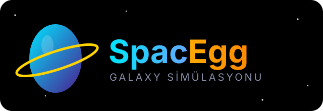

  

  <b>Türkçe</b> · <a href="#english">English</a>

---

# SpacEgg (Türkçe)

SpacEgg, Android telefonda tarayıcıda çalışan, tek dosyalık (HTML + CSS + JavaScript) Türkçe bir **Galaxy simülasyonu** prototipidir. Kullanıcı bir galaksi yumurtası alır, yumurta çatlar, içinden bir gezegen doğar ve gezegen seviye seviye gelişir.

## Amaç

- Tarayıcıda, kurulum gerektirmeden çalışan, canlı bir gezegen gelişim simülasyonu sunmak.
- Gezegenin doğuşunu, soğumasını, atmosfer ve yüzey oluşumunu, yaşamın ortaya çıkışını ve sonraki çağları izletmek.
- Kullanıcıya gezegene bakım verme ve olaylara müdahale etme imkânı vermek.

## Logo

Logo `logo.svg` dosyasındadır: halkalı bir yumurta ve gradyanlı "SpacEgg" yazısı ("Spac" camgöbeği-mor, "Egg" sarı-turuncu). Altında "GALAXY SİMÜLASYONU" yazar.

Renk paleti:

| Renk | Kod | Kullanım |
|---|---|---|
| Uzay Siyahı | `#000000` | ana arka plan |
| Derin Lacivert | `#0B0F2A` | paneller |
| Nebula Moru | `#4B1D8F` | gölge, vurgu |
| Neon Camgöbeği | `#00E5FF` | marka, çerçeve |
| Yıldız Sarısı | `#FFD400` | alt başlık, fiyat |
| Plazma Yeşili | `#39FF14` | başarı |
| Mars Kırmızısı | `#FF4D2E` | hata, tehlike |
| Yıldız Beyazı | `#F2F2F2` | ana metin |
| Kozmik Gri | `#8A8FA8` | ikincil metin |

Yazı tipleri: Poppins (başlık, logo, düğme, fiyat) ve Inter (metin). İkisi de dosyaya gömülüdür.

## Akış

1. Giriş (demo hesap ve kalıcı hesap).
2. Yumurta mağazası: 6 yumurta (Nebula $10, Süpernova $30, Pulsar $20, Kuasar $50, Kara Delik $75, Kozmik ücretsiz, 10 rozetle açılır).
3. Ödeme (**TEST MODU**, gerçek ödeme alınmaz): 12 yöntem.
4. Gezegene ad verme.
5. Yükleme.
6. Canlı simülasyon: yumurta çatlar, gezegen doğar ve gelişir.

## Özellikler

- **13 gezegen türü:** okyanus, çöl, lav, kayalık, buz, gaz devi, buz devi, karbon, derin okyanus, kthonyen çekirdek, pulsar gezegeni, serbest gezegen, mini-Neptün.
- **50 seviye:** 8. seviyeden sonra her seviye daha uzun sürer.
- **3 görünüm:** 3B (WebGL), gerçek 2B, 8 bit.
- **Olay sistemi:** jeoloji, deprem, atmosfer, kimya, yağış, yaşam, yıldız, asteroit, manyetik, komşu gezegen ve yok oluş olayları; zincirleme, koşullu, mevsim ve iklim olayları.
- **Yaşam zaman çizelgesi:** deniz, buz altı ve kara yaşamı; seviye 20'den sonra gerçek ve deneysel türler.
- **Harita:** 8 bölgeye yakınlaştırma, olay ikonları, kıta, deniz, ada ve dağ adları.
- **Oyuncu etkileşimi:** enerji, atmosfer/kalkan/yaşam eylemleri, karar kartları, komşu gezegen seçimleri, rozetler ve oyuncu seviyesi.
- **Gezegen mağazası:** 63 ürün, seviye 3–50 arası, seviye başına alım limiti.
- **Uydular:** kendi yörünge periyotlarıyla; seviye 29'dan sonra uydu sağlığı ve uydu gönderileri.
- **Ses:** 21 gömülü ses dosyası, kodla üretilen sesler, 48 parçalık karışık müzik, parçalar arası 6 saniyelik yumuşak geçiş.
- **Kalıcı hesap:** kayıt tarayıcıda (`localStorage`) tutulur; uygulama kapalıyken gezegen gerçek saat hızında ilerler; profil yedeği indirilebilir.

## Çalıştırma

Depodaki `spacegg-v71.html` dosyasını bir tarayıcıda açmak yeterlidir. Kurulum, derleme veya sunucu gerekmez.

## Durum ve sınırlar

- Bu depodaki dosya **v0.71** sürümüdür. Proje notlarında güncel sürüm v0.75 olarak geçer.
- Ödeme test modundadır; gerçek ödeme yoktur.
- Hesaplar yalnızca tarayıcıda saklanır, sunucu yoktur; tarayıcı verisi silinirse kayıt gider. Bu gerçek bir güvenlik sistemi değildir.
- Giriş şeridindeki sayaçlar örnek veridir.
- Gerçek Android telefonda performans ölçülmedi.

## Depodaki dosyalar

| Dosya | İçerik |
|---|---|
| `spacegg-v71.html` | Simülasyon (tek dosya) |
| `logo.svg` | Logo |
| `SPACEGG.md` | Ayrıntılı proje hafızası ve sürüm geçmişi |
| `SpacEgg-proje-ozeti.md` | Eksiksiz proje özeti |
| `SpacEgg-proje-talimatlari.md` | Proje çalışma talimatları |

---

# SpacEgg (English)

SpacEgg is a single-file (HTML + CSS + JavaScript) **Galaxy simulation** prototype in Turkish that runs in a browser on an Android phone. The user buys a galaxy egg, the egg hatches, a planet is born and develops level by level.

## Purpose

- Provide a live planet-evolution simulation that runs in the browser with no installation.
- Show a planet's birth, cooling, atmosphere and surface formation, the emergence of life and the later ages.
- Let the user care for the planet and respond to events.

## Logo

The logo is in `logo.svg`: a ringed egg and a gradient "SpacEgg" wordmark ("Spac" cyan-purple, "Egg" yellow-orange), with "GALAXY SİMÜLASYONU" below it.

Color palette:

| Color | Code | Use |
|---|---|---|
| Space Black | `#000000` | main background |
| Deep Navy | `#0B0F2A` | panels |
| Nebula Purple | `#4B1D8F` | shadow, accent |
| Neon Cyan | `#00E5FF` | brand, borders |
| Star Yellow | `#FFD400` | subtitle, price |
| Plasma Green | `#39FF14` | success |
| Mars Red | `#FF4D2E` | error, danger |
| Star White | `#F2F2F2` | main text |
| Cosmic Gray | `#8A8FA8` | secondary text |

Fonts: Poppins (headings, logo, buttons, prices) and Inter (body text). Both are embedded in the file.

## Flow

1. Login (demo account and persistent account).
2. Egg shop: 6 eggs (Nebula $10, Supernova $30, Pulsar $20, Quasar $50, Black Hole $75, Cosmic free, unlocked with 10 badges).
3. Payment (**TEST MODE**, no real payment is taken): 12 methods.
4. Naming the planet.
5. Loading.
6. Live simulation: the egg hatches, the planet is born and develops.

## Features

- **13 planet types:** ocean, desert, lava, rocky, ice, gas giant, ice giant, carbon, deep ocean, chthonian core, pulsar planet, rogue planet, mini-Neptune.
- **50 levels:** after level 8 each level takes longer.
- **3 views:** 3D (WebGL), realistic 2D, 8-bit.
- **Event system:** geology, earthquake, atmosphere, chemistry, precipitation, life, star, asteroid, magnetic, neighbor planet and extinction events; chained, conditional, seasonal and climate events.
- **Life timeline:** marine, subglacial and land life; real and experimental species after level 20.
- **Map:** zoom into 8 regions, event icons, names for continents, seas, islands and mountains.
- **Player interaction:** energy, atmosphere/shield/life actions, decision cards, neighbor planet choices, badges and player level.
- **Planet shop:** 63 items across levels 3–50, with a per-level purchase limit.
- **Moons:** with their own orbital periods; moon health and moon shipments after level 29.
- **Audio:** 21 embedded sound files, code-generated sounds, a 48-track shuffled music player with 6-second crossfades.
- **Persistent account:** the save is kept in the browser (`localStorage`); the planet advances at real-time speed while the app is closed; the profile backup can be downloaded.

## Running

Open `spacegg-v71.html` from this repository in a browser. No installation, build or server is needed.

## Status and limits

- The file in this repository is version **v0.71**. The project notes list the current version as v0.75.
- Payment is in test mode; there is no real payment.
- Accounts are stored only in the browser and there is no server; the save is lost if browser data is cleared. This is not a real security system.
- The counters in the login ticker are sample data.
- Performance on a real Android phone has not been measured.

## Files in this repository

| File | Content |
|---|---|
| `spacegg-v71.html` | The simulation (single file) |
| `logo.svg` | Logo |
| `SPACEGG.md` | Detailed project memory and version history |
| `SpacEgg-proje-ozeti.md` | Complete project summary |
| `SpacEgg-proje-talimatlari.md` | Project working instructions |
